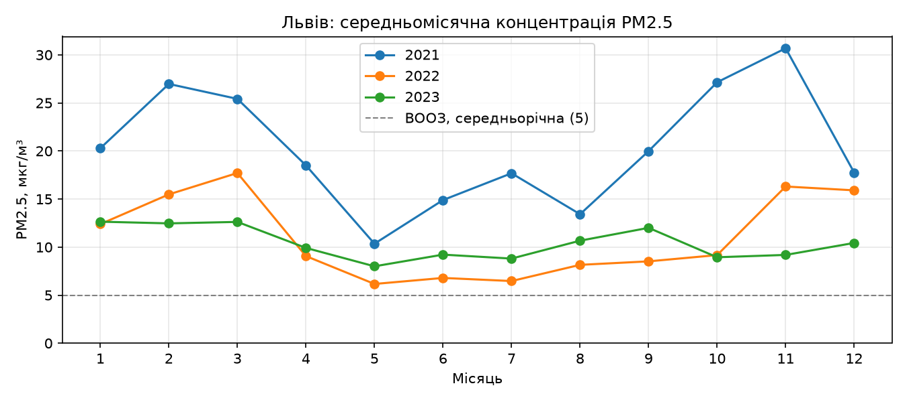
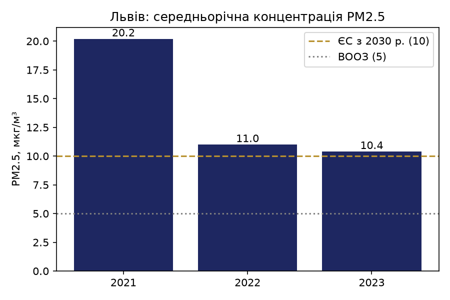
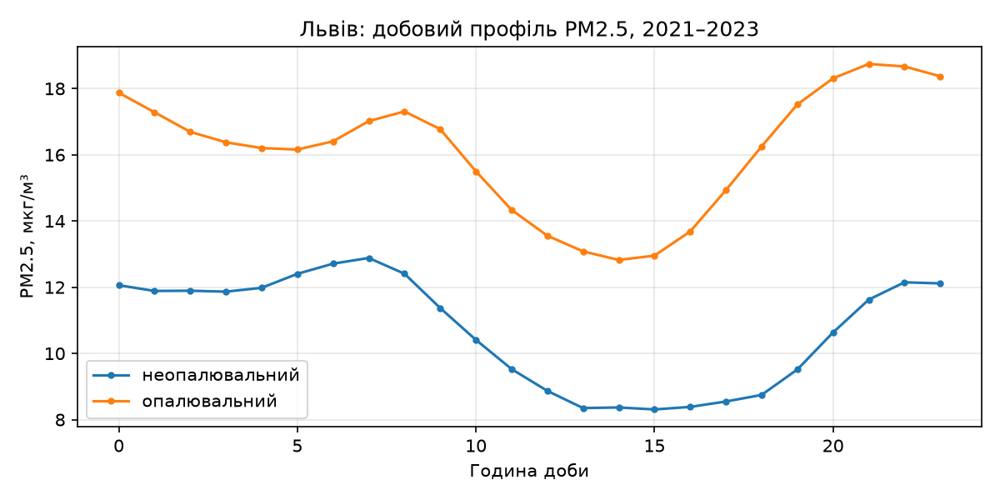
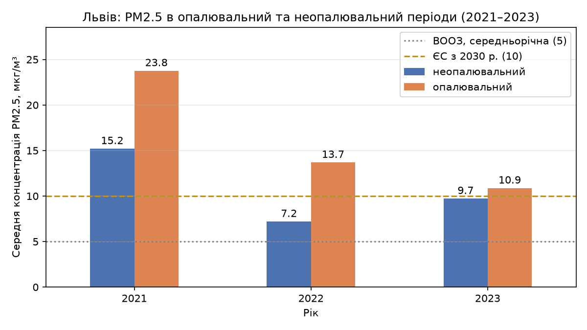

# Практична робота № 4. Відкриті міські дані та індикатори сталості

## 1. Тема, варіант, місто і питання дослідження
* **Варіант:** № 3
* **Місто:** м. Львів, Львівська область (`city_id = 245`, `slug = lviv`)
* **Період дослідження:** 2021–2023 рр.
* **Питання дослідження (обов'язкова частина):** Як змінювалася якість повітря у Львові у 2021–2023 рр. за стандартизованими індикаторами сталості (ISO 37120, ЦСР 11.6.2) порівняно з нормативами ВООЗ (2021) та ЄС (2030), і наскільки надійними є ці дані?
* **Питання дослідження (творча частина, варіант 3):** Внесок опалення — наскільки середня концентрація PM2.5 в опалювальний період (жовтень–квітень) вища, ніж у неопалювальний (травень–вересень), і як цей розрив змінювався у 2021–2023 рр.?

---

## 2. Дані
* **Назва набору:** «Щогодинні концентрації та індекс якості атмосферного повітря для дрібнодисперсного пилу фракції 2.5 мікронів в населених пунктах України»
* **Посилання на портал відкритих даних:** [data.gov.ua](https://data.gov.ua/dataset/402d427f-f024-465a-97a9-5ed29f510015)
* **Розпорядник:** Громадська організація «SaveDnipro» (система SaveEcoBot)
* **Ліцензія:** Creative Commons Attribution (CC BY)
* **Використані файли (завантажуються скриптом `scripts/download_data.py` у `data/raw/`):**
  * `saveecobot_aqi_cities.csv` — довідник населених пунктів (753 записи);
  * `saveecobot_cities_pm25_and_aqi_pm25_2021.csv` — щогодинні виміри за 2021 р. (8 745 рядків для Львова);
  * `saveecobot_cities_pm25_and_aqi_pm25_2022.csv` — щогодинні виміри за 2022 р. (8 766 рядків для Львова);
  * `saveecobot_cities_pm25_and_aqi_pm25_2023.csv` — щогодинні виміри за 2023 р. (8 760 рядків для Львова).

---

## 3. Якість даних

### Очищення даних
* Завантажено **26 271** погодинний запис для м. Львів за 2021–2023 рр.
* **Пропуски (`NULL`):** виявлено **8** порожніх значень у стовпці `pm25` (усі припадають на технічний збій 24 вересня 2021 р.). Пропуски не замінювалися нулями, щоб не занижувати середні показники.
* **Фізично неможливі значення (< 0 або > 1000 мкг/м³):** виявлено **0** записів.
* **Дублікати:** виявлено **8** повних дублікатів рядків (повторів годинної позначки `logged_at`), які видалено.
* **Порядок записів:** дані відсортовано хронологічно за індексом `logged_at`. Після очищення залишилося **26 255** валідних вимірів (середнє — 13,9 мкг/м³, медіана — 10,9 мкг/м³, максимум — 101,8 мкг/м³).

### Таблиця повноти даних за місяцями, %
| Місяць | 2021 | 2022 | 2023 |
| :--- | :---: | :---: | :---: |
| **1 (Січень)** | 100,0 | 100,0 | 100,0 |
| **2 (Лютий)** | 100,0 | 100,0 | 100,0 |
| **3 (Березень)** | 99,9 | 99,9 | 99,9 |
| **4 (Квітень)** | 100,0 | 100,0 | 100,0 |
| **5 (Травень)** | 100,0 | 100,0 | 100,0 |
| **6 (Червень)** | 100,0 | 100,0 | 100,0 |
| **7 (Липень)** | 100,0 | 100,0 | 100,0 |
| **8 (Серпень)** | 100,0 | 100,0 | 100,0 |
| **9 (Вересень)** | 96,9 | 100,0 | 100,0 |
| **10 (Жовтень)** | 100,0 | 100,0 | 100,0 |
| **11 (Листопад)** | 100,0 | 100,0 | 100,0 |
| **12 (Грудень)** | 100,0 | 100,0 | 100,0 |

### Пояснення пропусків
1. **Березень (99,9% щороку):** в останню неділю березня відбувається перехід на літній час (годинник переводять з 03:00 на 04:00), тому година `03:00` у місцевому часі не існує. Це особливість часових поясів, а не втрата даних.
2. **Вересень 2021 р. (96,9%):** найдовші неперервні пропуски зафіксовано 24.09.2021 з 23:00 (9 год), 26.09.2021 з 22:00 (8 год) та 24.09.2021 з 14:00 (3 год). Ці збої спостерігаються одночасно в усіх містах набору даних, отже вони спричинені технічними роботами/збоєм сервера SaveEcoBot, а не локальними відключеннями у Львові.
3. **Вплив на висновки:** за весь трирічний період лише **1 доба з 1095** виявилася недійсною (< 18 годинних вимірів, у вересні 2021 р.). Річна повнота становить 99,7–100,0%, що значно вище порогу надійності (90%).

---

## 4. Індикатори сталості (ISO 37120, ЦСР 11.6.2)

| Рік | Середньорічна PM2.5, мкг/м³ | Дійсних діб | Діб у році | Діб > 15 мкг/м³ (ВООЗ) | Діб > 25 мкг/м³ (ЄС-2030) | Повнота, % | Надійно | Рівень ВООЗ | У разів вище ВООЗ (5 мкг/м³) |
| :---: | :---: | :---: | :---: | :---: | :---: | :---: | :---: | :---: | :---: |
| **2021** | 20,2 | 364 | 365 | 243 | 88 | 99,7 | Так | IT-2 | 4,0 |
| **2022** | 11,0 | 365 | 365 | 86 | 11 | 100,0 | Так | IT-3 | 2,2 |
| **2023** | 10,4 | 365 | 365 | 49 | 5 | 100,0 | Так | IT-3 | 2,1 |

### Ручна перевірка розрахунків для 2023 р.
* **Повнота року:** $P_{2023} = \frac{365}{365} \cdot 100\% = 100,0\% \ge 90\%$ — значення надійне.
* **Рівень проміжних цілей ВООЗ:** $10 < \overline{C}_{2023} = 10,4 \le 15 \Rightarrow$ рівень **IT-3**.
* **Кратність перевищення настанови ВООЗ (5 мкг/м³):** $K_{2023} = \frac{10,4}{5} = 2,08 \approx 2,1$ раза.
* **Перевищення добових нормативів:** за 2023 р. зафіксовано 49 діб понад норму ВООЗ (15 мкг/м³, допускається 3–4 на рік) та 5 діб понад перспективну норму ЄС-2030 (25 мкг/м³, допускається до 18 на рік — за цим критерієм у 2022–2023 рр. місто вкладається в ліміт).

---

## 5. Графіки

### Середньомісячна концентрація PM2.5 у Львові (2021–2023)

### Середньорічна концентрація PM2.5 порівняно з нормативами ВООЗ та ЄС

### Добовий профіль PM2.5 в опалювальний і неопалювальний періоди

---

## 6. Творча частина (Варіант 3): Внесок опалювального періоду

* **Гіпотеза:** В опалювальний період (жовтень–квітень) середня концентрація PM2.5 у Львові є суттєво вищою (в 1,4–1,8 раза), ніж у неопалювальний (травень–вересень), через спалювання палива для опалення та гірші метеорологічні умови розсіювання домішок у холодну пору року; у 2022–2023 рр. абсолютний розрив між сезонами зменшився порівняно з 2021 р.
* **Метод:** Дійсні середньодобові значення (`count >= 18`) згруповано за роками та сезонами: опалювальний (місяці 10, 11, 12, 1, 2, 3, 4) і неопалювальний (місяці 5, 6, 7, 8, 9). Обчислено середні сезонні концентрації, абсолютний розрив ($\Delta C = C_{\text{опал}} - C_{\text{неопал}}$, мкг/м³) та кратність перевищення ($C_{\text{опал}} / C_{\text{неопал}}$).

### Результати порівняння сезонів
| Період | Неопалювальний (трав–вер), мкг/м³ | Опалювальний (жовт–квіт), мкг/м³ | Різниця, мкг/м³ | Кратність (у скільки разів вище) |
| :--- | :---: | :---: | :---: | :---: |
| **2021** | 15,21 | 23,77 | +8,56 | 1,56 |
| **2022** | 7,21 | 13,70 | +6,49 | 1,90 |
| **2023** | 9,73 | 10,88 | +1,15 | 1,12 |
| **2021–2023 (разом)** | **10,70** | **16,12** | **+5,42** | **1,51** |

* **Відповідь на питання варіанта:** Гіпотеза підтвердилася. У середньому за 2021–2023 рр. концентрація PM2.5 у Львові в опалювальний період (**16,12 мкг/м³**) на **5,42 мкг/м³** (або в **1,51 раза**) вища, ніж у неопалювальний (**10,70 мкг/м³**). У 2021 р. сезонний розрив становив **+8,56 мкг/м³** (1,56 раза), у 2022 р. абсолютна різниця зменшилася до **+6,49 мкг/м³**, проте відносний розрив зріс до **1,90 раза** (через дуже низькі літні показники 2022 р. та використання генераторів і твердого палива восени–взимку), а у 2023 р. розрив скоротився до мінімальних **+1,15 мкг/м³** (1,12 раза) на тлі м'якої зими та відсутності осінньо-зимових піків забруднення.

---

## 7. Висновки й обмеження
1. **Загальна тенденція:** У 2021–2023 рр. середньорічна концентрація PM2.5 у Львові знизилася майже вдвічі — з **20,2 мкг/м³** (рівень ВООЗ IT-2) у 2021 р. до **11,0 мкг/м³** у 2022 р. та **10,4 мкг/м³** у 2023 р. (рівень IT-3). Кількість діб із перевищенням добової настанови ВООЗ (15 мкг/м³) скоротилася з 243 до 49 на рік, а перевищень норми ЄС-2030 (25 мкг/м³) — з 88 до 5 діб. Проте середньорічний показник 2023 р. (**10,4 мкг/м³**) усе ще у **2,1 раза** перевищує настанову ВООЗ (5 мкг/м³) і трохи перевищує майбутній стандарт ЄС-2030 (10 мкг/м³).
2. **Внесок опалення та добовий хід:** Опалювальний період формує основне забруднення повітря у місті (у середньому в 1,51 раза вище за теплий період). На добовому профілі чітко видно ранковий (07:00–08:00) та виражений вечірній максимум (20:00–23:00, до ~18,7 мкг/м³ в опалювальний сезон), пов'язаний із піками автотранспорту, побутового опалення та нічною температурною інверсією.
3. **Надійність даних:** Повнота даних становить 99,7–100,0%, тому обчислені індикатори є статистично надійними.
4. **Обмеження та яких даних бракує:**
   * Дані зібрані мережею недорогих оптичних сенсорів громадського моніторингу SaveEcoBot, а не державними референтними станціями (можливе завищення показників при високій вологості повітря та туманах, характерних для Львова).
   * У наборі відсутні метадані про кількість активних датчиків у місті в конкретний момент часу та їхнє просторове розташування по районах (зміна складу мережі сенсорів між 2021 і 2023 рр. могла частково вплинути на зафіксоване зниження концентрацій).
   * Для точнішого відокремлення внеску опалення від транспорту й метеорології бракує даних про температуру повітря, швидкість вітру, дати офіційного старту/завершення опалювального сезону у Львові та інтенсивність трафіку.

---

## 8. Журнал використання ШІ
| Етап роботи | Суть звернення | Результат та перевірка |
| :--- | :--- | :--- |
| Творча частина (графіка) | Допомога з синтаксисом групованої стовпчикової діаграми в `matplotlib` (`bar_label`, додавання горизонтальних ліній нормативів) | Код перевірено, підписи осей та значення нормативів ВООЗ (5 мкг/м³) і ЄС (10 мкг/м³) звірено з таблицею розрахунків |