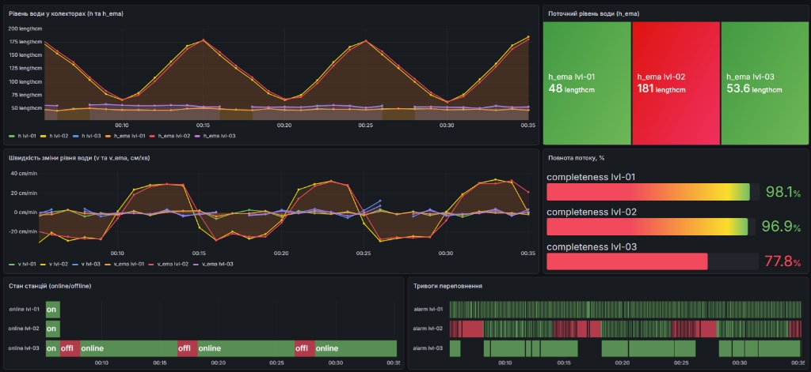
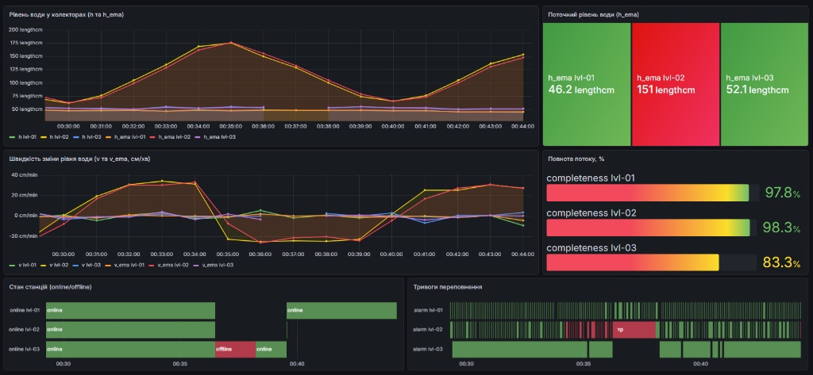

# Практична робота № 5. IoT-конвеєр міської інфраструктури (Варіант 3: Зливові колектори)

**Студент:** Корнієнко Максим Вячеславович, група М КН 2026-1  
**Варіант:** № 3  
**Дата:** 18.11.2026

---

## 1. Архітектура конвеєра
Розгорнуто багатокомпонентний IoT-конвеєр моніторингу рівня води у зливових колекторах на базі Docker Compose (`pr5-iot`):

`[Симулятор lvl-01..03] --(MQTT QoS 1)--> [Mosquitto :1883] --> [Node-RED :1880] --(SQL INSERT + Buffer)--> [PostgreSQL :5433] <--(SQL SELECT)-- [Grafana :3000]`

| Сервіс | Образ / Версія | Порт (хост:контейнер) | Призначення |
| :--- | :--- | :---: | :--- |
| **mosquitto** | `eclipse-mosquitto:2.0.22` | `1883:1883` | MQTT-брокер (обмін телеметрією, статусами LWT, тривогами) |
| **nodered** | `pr5-nodered:4.1` | `1880:1880` | Валідація даних, розрахунок швидкості $v_t$, EMA, гістерезису та буфер Store-and-Forward |
| **postgres** | `postgres:16` | `5433:5432` | Реляційне сховище часових рядів (`storm_drains`, `station_status`) |
| **grafana** | `grafana/grafana:12.4` | `3000:3000` | Візуалізація показників, стану станцій, тривог і повноти потоку |

---

## 2. Модель даних та навантаження MQTT

### Схема тем MQTT та формат повідомлень
* `kharkiv/drains/<id>/telemetry` (`QoS 1`, `retain = false`) — виміри рівня води кожні 5 с:
  `{"ts": 1792509494167, "h": 47.6}`
* `kharkiv/drains/<id>/status` (`QoS 1`, `retain = true`, Last Will) — стан з'єднання пристрою: `"online"` або `"offline"`.
* `kharkiv/drains/<id>/alarm` (`QoS 1`, `retain = true`) — подія зміни стану тривоги:
  `{"ts": 1792509650000, "alarm": 1, "h_ema": 151.4, "v_ema": 2.95}`

### Оцінка навантаження на мережу та сховище
Для $n = 3$ станцій, періоду вимірювання $\Delta t = 5\text{ с}$ та середнього розміру пакета з темою і заголовками $b \approx 75\text{ байт}$:
* Кількість повідомлень за годину:
  $$M = n \cdot \frac{3600}{\Delta t} = 3 \cdot \frac{3600}{5} = 2160\text{ повідомлень/год}$$
* Обсяг переданих даних за добу:
  $$V = n \cdot \frac{86400}{\Delta t} \cdot b = 3 \cdot 17280 \cdot 75 \approx 3{,}89\text{ МБ/добу}$$

### Схема бази даних (`postgres/init/01_schema.sql`)
* **`storm_drains`** (`PRIMARY KEY (station, ts)`): зберігає `ts` (`timestamptz`), `station` (`text`), рівень `h` (`real`, обмеження `CHECK (h BETWEEN 0 AND 300)`), згладжений рівень `h_ema` (`real`), швидкість зміни рівня `v` (`real`), згладжену швидкість `v_ema` (`real`), прапорець тривоги `alarm` (`smallint`, `CHECK (alarm IN (0, 1))`) та затримку конвеєра `lag_ms` (`integer`). Складений первинний ключ `(station, ts)` разом із `ON CONFLICT DO NOTHING` забезпечує ідемпотентність запису при повторній доставці повідомлень із `QoS 1`.
* **`station_status`**: фіксує моменти зміни статусу пристроїв (`online` $\in \{0, 1\}$).

---

## 3. Обробка потоку в Node-RED та ручна перевірка

1. **Валідація вимірів:** відкидаються пакети з некоректним типом даних або виходом за фізичні межі $0 \le h \le 300\text{ см}$ (імітація збоїв сенсора `-5.0` та `999.0` см з імовірністю 2%).
2. **Швидкість зміни рівня води ($v_t$, см/хв):**
   $$v_t = \frac{h_t - h_{t-1}}{\Delta t} \cdot 60$$
3. **Експоненційне згладжування (EMA):**
   * Для рівня води ($\alpha_h = 0{,}3$): $h_{\text{EMA}, t} = 0{,}3 \cdot h_t + 0{,}7 \cdot h_{\text{EMA}, t-1}$
   * Для швидкості ($\alpha_v = 0{,}25$): $v_{\text{EMA}, t} = 0{,}25 \cdot v_t + 0{,}75 \cdot v_{\text{EMA}, t-1}$
4. **Тривога з гістерезисом:** вмикається при $h_{\text{EMA}} \ge 150\text{ см}$ ($\theta_{\text{on}}$), вимикається при $h_{\text{EMA}} \le 120\text{ см}$ ($\theta_{\text{off}}$). Зона нечутливості шириною $30\text{ см}$ запобігає «брязкоту» тривоги через хвилювання поверхні води.
5. **Сценарій зливи у симуляторі:** задано `RAIN = ("lvl-02", 60, 300, 30.0)` та спад рівня після зливи `25.0 см/хв`, що забезпечує досягнення піку $\approx 178\text{–}181\text{ см}$ (увімкнення тривоги) і спад до $\approx 65\text{ см}$ (вимкнення тривоги) у межах кожного 10-хвилинного циклу.

### Ручна перевірка розрахунків
Нехай для станції `lvl-02` о $t_0$ зафіксовано $h_0 = 149{,}0\text{ см}$ ($h_{\text{EMA}, 0} = 148{,}5\text{ см}$, $v_{\text{EMA}, 0} = 2{,}80\text{ см/хв}$), а через $\Delta t = 5\text{ с}$ під час зливи надійшло $h_1 = 153{,}5\text{ см}$:
* Швидкість: $v_1 = \frac{153{,}5 - 149{,}0}{5} \cdot 60 = 54{,}0\text{ см/хв}$ (при плавному зростанні $+0{,}25\text{ см}$ за $5\text{ с}$: $v_1 = \frac{0{,}25}{5} \cdot 60 = 3{,}0\text{ см/хв}$).
* Згладжений рівень: $h_{\text{EMA}, 1} = 0{,}3 \cdot 153{,}5 + 0{,}7 \cdot 148{,}5 = 46{,}05 + 103{,}95 = 150{,}0\text{ см}$.
* Оскільки $h_{\text{EMA}, 1} = 150{,}0 \ge 150\text{ см}$, стан `alarm` перемикається з `0` на `1`, і публікується retained-повідомлення у `kharkiv/drains/lvl-02/alarm`.

---

## 4. Дашборд Grafana (прогін 30+ хв)

Дашборд містить 6 панелей (експортовано у `grafana/dashboards/pr5.json`):
1. **Рівень води у колекторах (`h` та `h_ema`)** — часовий ряд динаміки заповнення колекторів (видно періодичні підйоми рівня `lvl-02` до ~181 см та спади до ~65 см).
2. **Поточний рівень води (`h_ema`)** — індикатори `Stat` із кольоровою індикацією порогів (`< 120 см` — зелений, `120–150 см` — жовтий, `≥ 150 см` — червоний).
3. **Швидкість зміни рівня води (`v` та `v_ema`, см/хв)** — часовий ряд інтенсивності притоку та відтоку.
4. **Повнота потоку, %** — індикатори `Bar gauge` за формулою $P = \frac{N}{T / \Delta t} \cdot 100\%$. За 30 хвилин роботи зафіксовано: **`lvl-01` — 98,1 %**, **`lvl-02` — 96,9 %**, **`lvl-03` — 77,8 %**.
5. **Стан станцій (`online`/`offline`)** — часова шкала `State timeline`, де видно три планові переходи `lvl-03` у червоний стан `offline`.
6. **Тривоги переповнення** — хронологія спрацювань аварійного рівня (чітко видно 4 цикли увімкнення та автоматичного вимкнення тривоги на `lvl-02`).

---

## 5. Експеримент зі стійкістю та буфер «зберегти–переслати»

| Експеримент | Хто зберіг дані | Виміряні показники (час / втрати / розрив) | Патерн стійкості |
| :--- | :--- | :--- | :--- |
| **А. Знеструмлення пристрою `lvl-03`** (120 с у циклі) | Ніхто (сенсор не працював) | Статус `offline` з'явився через **17 с** ($1{,}5k$); втрачено **24 записи**; розрив **120 с** | Last Will (`offline`), плавна деградація |
| **Б. Зупинка Node-RED** (`docker compose stop nodered` на 60 с) | Брокер Mosquitto | Втрачено **0 записів** (усі 36 повідомлень доставлено після старту); розрив **0 с** | Постійна сесія (`clean session = false`, `QoS 1`) + `ON CONFLICT DO NOTHING` |
| **В. Зупинка PostgreSQL** (`docker compose stop postgres` на 40 с) | Черга вузла БД та буфер `flow.pg_buffer` у Node-RED | Перехоплено **25 записів** (24 у черзі вузла + 1 у буфері `catch`); втрачено **0 записів**; розрив **0 с** | Патерн **«зберегти–переслати» (Store-and-Forward)** + ідемпотентна вставка |

### Реалізація буфера Store-and-Forward (додаткове завдання)
Для усунення втрати даних при тимчасовій відмові PostgreSQL (експеримент В) у потік Node-RED додано буферну чергу `flow.pg_buffer`:
* При помилці вставки вузол `catch` передає параметри запиту (`msg.params`) у функціональний вузол буфера, де вони накопичуються у масиві в оперативній пам'яті.
* Вузол `inject` щосекунди ініціює вибірку з черги та повторну відправку до вузла `PostgreSQL: виміри` (ідемпотентність гарантується `ON CONFLICT (station, ts) DO NOTHING`).
* **Перевірка:** під час зупинки контейнера `postgres` на 40 с усі 25 пропущених вимірів було утримано в пам'яті Node-RED; після запуску БД записи автоматично завантажилися в таблицю `storm_drains`, а розрив на графіку Grafana повністю зник (видно лише планове 2-хвилинне знеструмлення `lvl-03`).

---

## 6. Відповідь на творче питання, висновки та обмеження

### Творче питання (виграш часу при тривозі за швидкістю $v_{\text{EMA}}$)
У сценарії зливи на станції `lvl-02` початковий рівень води становить $h_0 \approx 60\text{ см}$, аварійний поріг рівня — $\theta_{\text{on}} = 150\text{ см}$ (запас до переповнення $\Delta h = 90\text{ см}$), а швидкість підйому води під час зливи становить $v = 3{,}0\text{ см/хв}$:
* **За порогом рівня ($h_{\text{EMA}} \ge 150\text{ см}$):** тривога спрацює лише тоді, коли вода підніметься на $90\text{ см}$, тобто через:
  $$t_{\text{рівень}} = \frac{90\text{ см}}{3{,}0\text{ см/хв}} = 30\text{ хвилин}$$
* **За порогом швидкості ($v_{\text{EMA}} \ge 2{,}0\text{ см/хв}$):** з урахуванням згладжування ($\alpha_v = 0{,}25$) показник $v_{\text{EMA}}$ перетне межу $2{,}0\text{ см/хв}$ вже на 4-му кроці вимірювань, тобто через:
  $$t_{\text{швидкість}} = 4 \times 5\text{ с} = 20\text{ секунд} \approx 0{,}33\text{ хвилини}$$
* **Виграш у часі попередження:**
  $$\Delta t_{\text{виграш}} = 30 - 0{,}33 \approx 29{,}7\text{ хвилин}$$
Отже, контроль згладженої швидкості $v_{\text{EMA}}$ дає диспетчерській службі майже **30 хвилин запасу** до фактичного затоплення колектора.

### Висновки та обмеження
1. **Продуктивність:** конвеєр із 4 контейнерів стабільно обробляє $2160\text{ повідомлень/год}$ із затримкою запису $3\text{–}12\text{ мс}$.
2. **Якість та повнота даних:** фільтрація відсіяла $\approx 1{,}9\text{–}3{,}1\%$ викидів сенсорів (`-5.0` та `999.0` см); повнота потоку за 30 хвилин для безперервних станцій склала **98,1 %** (`lvl-01`) та **96,9 %** (`lvl-02`), а для `lvl-03` — **77,8 %** через планові 2-хвилинні знеструмлення.
3. **Обмеження:** дані генеруються програмним симулятором; MQTT-брокер налаштований без TLS та автентифікації (`allow_anonymous true`); реалізований у Node-RED буфер `flow.pg_buffer` зберігається **в оперативній пам'яті (RAM)**, тому при перезапуску контейнера Node-RED або повному Deploy накопичені в буфері дані зникають (для енергонезалежності необхідно увімкнути файловий контекст `localfilesystem` у `settings.js` або використати SQLite).

---

## 7. Журнал використання ШІ
* **Інструмент:** Gemini.
* **Мета та обсяг використання:** використовувався як довідник для уточнення синтаксису SQL-макросів Grafana (`$__timeGroupAlias`, `$__unixEpochTo`), перевірки реалізації експоненційного згладжування та буфера Store-and-Forward у JavaScript для вузла `function` у Node-RED.
* **Виявлені та виправлені помилки:** у запропонованому шаблоні параметрів підключення вузла PostgreSQL у Node-RED прапорець SSL передавався як рядок `"false"`, що викликало помилку `The server does not support SSL connections`. Помилку виявлено під час тестування та виправлено вручну в налаштуваннях конфігураційного вузла (знято прапорець `Use SSL`).