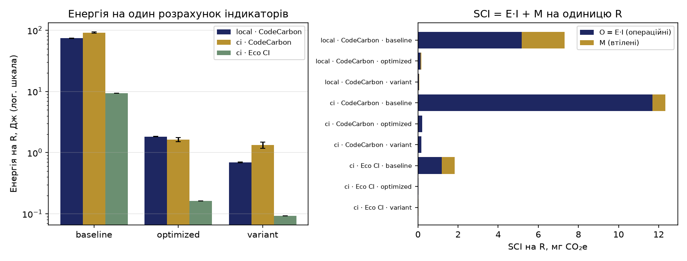

# Практична робота № 6. Вимірювання вуглецевої інтенсивності програмного забезпечення: CodeCarbon, Eco CI і метрика SCI (Варіант 3: Polars замість pandas)

**Студент:** Корнієнко Максим Вячеславович, група М КН 2026-1  
**Варіант:** № 3  
**Дата:** 19.11.2026

---

## 1. Об'єкт вимірювання та функціональна одиниця

* **Об'єкт дослідження:** програма розрахунку річних та добових індикаторів якості повітря за даними PM2.5 (SaveEcoBot, 2021–2023 рр.) для Києва (`city_id = 2`) та Харкова (`city_id = 219`) з урахуванням правила мінімум 18 валідних годин на добу, кількості діб із перевищенням норми ВООЗ ($15\text{ мкг/м}^3$) і норми ЄС ($25\text{ мкг/м}^3$), повноти ряду та рівня за проміжними цілями ВООЗ.
* **Функціональна одиниця ($R$):** один повний розрахунок підсумкової таблиці індикаторів для двох міст за три роки (6 комбінацій місто–рік).
* **Порівнювані реалізації:**
  * **`baseline` (`bench/baseline.py`):** базова реалізація на `pandas` із 5 типовими неефективностями (повторне читання CSV без фільтрації стовпців, порядковий парсинг дат через `apply(strptime)`, порядкова валідація через `apply(..., axis=1)`, цикл по 365 днях із повною фільтрацією таблиці на кожній ітерації, агрегація списками Python).
  * **`optimized` (`bench/optimized.py`):** оптимізована версія на `pandas` (одноразове зчитування 3 потрібних стовпців із явними типами `int32`/`float64`, векторний `pd.to_datetime`, векторний `between(0, 1000)`, єдине групування `groupby` за містом і добою та агрегація `agg()`).
  * **`variant` (`bench/variant.py`, Варіант 3):** реалізація на бібліотеці `polars` із використанням лінивого сканування `pl.scan_csv(..., null_values="NULL")`, багатопотокової векторної обробки, групувань `group_by` та конвертації фінальної агрегованої таблиці у `pandas.DataFrame`. Коректність усіх трьох версій підтверджено автоматичною перевіркою `python measure.py verify` (`OK`).

---

## 2. Середовища, способи вимірювання та параметри SCI

| Параметр | Локальне середовище (`local`) | Середовище CI (`ci`, GitHub Actions) |
| :--- | :--- | :--- |
| **ОС та апаратне забезпечення** | Windows 11, ноутбук **Lenovo IdeaPad Gaming 3 15IAH7** (12th Gen Intel Core i5-12450H, TDP 85 Вт, NVIDIA RTX 3060) | Ubuntu (`ubuntu-latest`, Azure), AMD EPYC 7763 (4 vCPU зі 128, публічний репозиторій) |
| **Інструмент і версія** | CodeCarbon `3.3.2` (`OfflineEmissionsTracker`) | CodeCarbon `3.3.2` + Eco CI `v5.3.0` |
| **Спосіб отримання потужності CPU** | **`windows_emi` — прямий вимір** апаратними лічильниками Energy Meter Interface (перевірено `measure.py check`) | **`cpu_load` — модельна оцінка** CodeCarbon ($P = \text{TDP}\cdot(0{,}1 + 0{,}9 L^3)$, $\text{TDP} = 280\text{ Вт}$) та SPECpower-крива $P(u)$ в Eco CI |
| **Оцінка потужності RAM** | Модельна оцінка CodeCarbon (`10.0 Вт`) | Модельна оцінка CodeCarbon (`10.0 Вт`); у Eco CI враховано в кривій сервера |
| **Середня потужність простою ($\overline{P}_{\text{прост}}$)** | **29,75 Вт** ($n = 3$ по 20 с) | CodeCarbon: **38,04 Вт**; Eco CI: **2,39 Вт** |
| **Вуглецева інтенсивність мережі ($I$)** | **250,47 г $\text{CO}_2\text{e}/\text{кВт}\cdot\text{год}$** (Україна, Ember Yearly Electricity Data 2026 / OWID, дані за 2022 р.) | **458,29 г $\text{CO}_2\text{e}/\text{кВт}\cdot\text{год}$** (світове середнє, Ember 2025; у параметрах Eco CI вказано `458`) |
| **Втілені викиди ($TE$) та строк служби ($EL$)** | $TE = 175{,}5\text{ кг CO}_2\text{e}$ ($260 - 84{,}5\text{ кг CO}_2\text{e}$ за PCF-звітом Lenovo IdeaPad Gaming 3 15IAH7), $EL = 4\text{ роки}$, $RR/ToR = 1$ | $TE_{\text{сервера}} = 1151{,}7\text{ кг CO}_2\text{e}$ (Boavizta, AMD EPYC 7763), частка раннера $4/128 \Rightarrow TE = 35\,990{,}6\text{ г CO}_2\text{e}$, $EL = 4\text{ роки}$ |

### Захист від небажаної передачі даних
* У **CodeCarbon** використано `OfflineEmissionsTracker` із явно заданим `country_iso_code="UKR"`, фіксованою інтенсивністю `force_carbon_intensity_g_co2e_kwh` та `save_to_file=False` (дашборд `save_to_api` не використовується) — трекер не робить жодних мережевих запитів і не визначає геолокацію за IP-адресою.
* В **Eco CI** задано `send-data: false`, `display-badge: false` та `co2-calculation-method: constant` (`co2-grid-intensity-constant: 458`), що повністю вимикає відправку телеметрії на `metrics.green-coding.io` та звернення до зовнішніх сервісів геолокації за IP.

---

## 3. Результати вимірювань та розрахунок SCI

Зведена таблиця результатів із `results/summary.csv` (формули (3)–(9)):

| Джерело (`source`) | Версія (`label`) | $n$ | $E_R$, Дж | $\pm \text{CI}_{95\%}$, Дж | $t_R$, с | $\overline{P}$, Вт | $O_R$, мг $\text{CO}_2\text{e}$ | $M_R$, мг $\text{CO}_2\text{e}$ | $\text{SCI}$, мг $\text{CO}_2\text{e}$ |
| :--- | :--- | :---: | :---: | :---: | :---: | :---: | :---: | :---: | :---: |
| `local · CodeCarbon` | `baseline` | 5 | 74,229 | 0,618 | 1,5460 | 48,01 | 5,1645 | 2,1509 | **7,3154** |
| `local · CodeCarbon` | `optimized` | 5 | 1,834 | 0,015 | 0,0380 | 48,26 | 0,1276 | 0,0529 | **0,1805** |
| `local · CodeCarbon` | `variant` (Polars) | 5 | 0,691 | 0,011 | 0,0113 | 61,29 | 0,0481 | 0,0157 | **0,0637** |
| `ci · CodeCarbon` | `baseline` | 3 | 91,914 | 2,628 | 2,2067 | 41,65 | 11,7008 | 0,6296 | **12,3305** |
| `ci · CodeCarbon` | `optimized` | 3 | 1,638 | 0,136 | 0,0382 | 42,83 | 0,2085 | 0,0109 | **0,2195** |
| `ci · CodeCarbon` | `variant` (Polars) | 3 | 1,332 | 0,151 | 0,0169 | 79,03 | 0,1696 | 0,0048 | **0,1744** |
| `ci · Eco CI` | `baseline` | 1 | 9,316 | — | 2,2645 | 4,11 | 1,1859 | 0,6461 | **1,8320** |
| `ci · Eco CI` | `optimized` | 1 | 0,162 | — | 0,0393 | 4,12 | 0,0206 | 0,0112 | **0,0318** |
| `ci · Eco CI` | `variant` (Polars) | 1 | 0,093 | — | 0,0174 | 5,35 | 0,0118 | 0,0050 | **0,0168** |

### Приклад перевірки розрахунку SCI (формула (7)) для `local · CodeCarbon · baseline`
* Енергія на розрахунок: $E_R = \frac{74{,}229\text{ Дж}}{3{,}6 \cdot 10^6\text{ Дж/кВт}\cdot\text{год}} \approx 2{,}0619 \cdot 10^{-5}\text{ кВт}\cdot\text{год}$.
* Операційні викиди (8): $O_R = E_R \cdot I = 2{,}0619 \cdot 10^{-5} \cdot 250{,}47 \approx 5{,}1645\text{ мг CO}_2\text{e}$.
* Втілені викиди (9): $M_R = 175\,500\text{ г} \cdot \frac{1{,}5460\text{ с}}{4 \cdot 365 \cdot 86\,400\text{ с}} \cdot 1 \approx 2{,}1509\text{ мг CO}_2\text{e}$.
* Підсумковий індекс: $\text{SCI} = 5{,}1645 + 2{,}1509 = 7{,}3154\text{ мг CO}_2\text{e}$ на один розрахунок $R$.

---

## 4. Порівняння «локально ↔ CI» та моделей інструментів

1. **Відтворюваність відносної економії та прискорення:**
   * **Локально (`CodeCarbon`, `windows_emi`):** версія `optimized` зменшила енергію на одиницю $R$ на **97,5 %** (прискорення у **40,7×**), а `variant` (Polars) — на **99,1 %** (прискорення у **136,8×**). 95%-ві довірчі інтервали ($74{,}229 \pm 0{,}618$, $1{,}834 \pm 0{,}015$ та $0{,}691 \pm 0{,}011\text{ Дж}$) не перетинаються, отже перевага обох оптимізованих версій статистично значуща.
   * **У GitHub Actions (`CodeCarbon`, `cpu_load`):** економія склала **98,2 %** (прискорення **57,8×**) для `optimized` та **98,6 %** (прискорення **130,6×**) для `variant`.
   * **У GitHub Actions (`Eco CI`):** економія склала **98,3 %** (прискорення **57,6×**) для `optimized` та **99,0 %** (прискорення **130,1×**) для `variant`.
   * Висновок про ефективність оптимізації повністю відтворюється у всіх трьох джерелах.

2. **Чому `ci · CodeCarbon` і `ci · Eco CI` відрізняються на порядок (~10×):**
   * На одному й тому самому раннері з процесором AMD EPYC 7763 для `baseline` CodeCarbon оцінив середню потужність у **41,65 Вт** ($E_R = 91{,}914\text{ Дж}$), тоді як Eco CI дав **4,11 Вт** ($E_R = 9{,}316\text{ Дж}$).
   * Причина полягає в різних моделях віртуалізації: CodeCarbon бачить модель фізичного 64-ядерного процесора EPYC 7763 із повним $\text{TDP} = 280\text{ Вт}$ і підставляє його у формулу (2) ($280 \cdot (0{,}1 + 0{,}9 L^3)$), додаючи ще $10\text{ Вт}$ на RAM, не знаючи, що віртуальна машина отримала лише 4 vCPU зі 128. Натомість модель Eco CI відкалібрована за даними SPECpower саме для частки 4 із 128 vCPU (діапазон потужності $1{,}76\text{–}8{,}18\text{ Вт}$).

3. **Частка втілених викидів ($M_R / \text{SCI}$):**
   * На ігровому ноутбуці Lenovo IdeaPad Gaming 3 15IAH7 ($TE = 175{,}5\text{ кг CO}_2\text{e}$) втілені викиди становлять **29,4 %** від загального SCI для `baseline` ($2{,}1509 / 7{,}3154$) і **24,6 %** для `variant` ($0{,}0157 / 0{,}0637$).
   * На раннері GitHub за оцінкою Eco CI частка втілених викидів ще вища — **35,3 %** для `baseline` ($0{,}6461 / 1{,}8320$) і **29,8 %** для `variant` ($0{,}0050 / 0{,}0168$), оскільки операційна потужність 4 віртуальних ядер сервера невелика (4–5 Вт), а втілені викиди серверного обладнання вагомі.

---

## 5. Енергоспоживання власного CI-конвеєра (`.github/workflows/ci.yml`)

До кожного з трьох завдань (`job`) конвеєра з Практичних робіт № 1–3 додано кроки `eco-ci-energy-estimation@v5.3.0`. За результатами запуску (`push` у гілку `main`, тривалість 56 с):

| Завдання (`job`) конвеєра `ci.yml` | Сер. завантаження CPU, % | Енергія, Дж | Сер. потужність, Вт | Тривалість, с | $\text{SCI}$ завдання, г $\text{CO}_2\text{e}$ |
| :--- | :---: | :---: | :---: | :---: | :---: |
| `build-and-test` | 33,33 | 7,27 | 4,35 | 1,67 | 0,001401 |
| `build-and-push-image` | 21,36 | 60,11 | 3,82 | 15,75 | 0,012141 |
| `deploy` | 36,88 | 57,34 | 4,59 | 12,48 | 0,010856 |
| **Разом за 1 запуск `ci.yml`** | — | **124,72** | — | **29,90** | **0,024398** |

*(Для порівняння: один повний запуск тестового конвеєра `pr6-energy.yml` спожив $1102{,}00\text{ Дж}$ за $267{,}80\text{ с}$ із $\text{SCI} = 0{,}216606\text{ г CO}_2\text{e}$).*

### Річна оцінка вуглецевого сліду конвеєра (формула (10))
Для команди розробки за параметрами прикладу з Лекції 6 ($n_{\text{розр}} = 20$ розробників, $n_{\text{push}} = 5$ комітів/день, $n_{\text{днів}} = 220$ робочих днів/рік):
$$N = 20 \cdot 5 \cdot 220 = 22\,000\text{ запусків/рік}$$
$$C_{\text{рік}} = N \cdot \text{SCI}_{\text{запуск}} = 22\,000 \cdot 0{,}024398\text{ г CO}_2\text{e} \approx 536{,}76\text{ г CO}_2\text{e/рік} \approx 0{,}537\text{ кг CO}_2\text{e/рік}$$
Річне енергоспоживання конвеєра складе $22\,000 \cdot 124{,}72\text{ Дж} \approx 2{,}74\text{ МДж}$ ($0{,}762\text{ кВт}\cdot\text{год/рік}$). Найбільшу частку енергії споживають кроки збірки та завантаження Docker-образу (`build-and-push-image` — 48,2 %) і розгортання інфраструктури (`deploy` — 46,0 %).

---

## 6. Результати варіанта № 3 (Polars замість pandas) та відповідь на творче питання

### Порівняння показників продуктивності та енергоефективності
* **Локально (`windows_emi`):** перехід з оптимізованого `pandas` (`optimized`) на `polars` (`variant`) скоротив час одного розрахунку $t_R$ у **3,36 раза** — з **0,0380 с** до **0,0113 с**, зменшивши енергію на одиницю роботи $E_R$ на **62,3 %** (з $1{,}834 \pm 0{,}015$ до $0{,}691 \pm 0{,}011\text{ Дж}$) та $\text{SCI}$ з **0,1805** до **0,0637 мг $\text{CO}_2\text{e}$** (економія **99,1 %** відносно `baseline`). При цьому середня потужність ноутбука $\overline{P}$ зросла з **48,26 Вт** до **61,29 Вт** ($+13{,}03\text{ Вт}$).
* **У GitHub Actions (`Eco CI`):** завантаження CPU зросло вдвічі — з **26,59 %** (`optimized`) до **53,35 %** (`variant`), середня потужність піднялася з **4,12 Вт** до **5,35 Вт**, але час розрахунку зменшився з **0,0393 с** до **0,0174 с** (у **2,26 раза**), що знизило енергію $E_R$ з **0,162 Дж** до **0,093 Дж** (додаткова економія **42,6 %** відносно `optimized`).

### Відповідь на творче питання
> *Polars за замовчуванням використовує всі ядра процесора. Чому потужність при цьому може зрости, а енергія на R — зменшитися? Чи завжди так?*

Бібліотека `pandas` виконує більшість операцій в одному потоці (завантажуючи переважно 1 ядро процесора), тоді як рушій `Polars` побудований на багатопотоковому виконанні запитів і задіює всі доступні ядра CPU одночасно. У наших вимірах на Intel Core i5-12450H це збільшило миттєву потужність $\overline{P}$ на **27 %** (з 48,26 Вт до 61,29 Вт), а на 4-ядерному раннері GitHub — на **30 %** (з 4,12 Вт до 5,35 Вт). Проте енергія дорівнює добутку потужності на час ($E_R = \overline{P} \cdot t_R$): оскільки паралельна обробка та векторні оптимізації скоротили час розрахунку $t_R$ у **3,36 раза** (на 70 %), сумарна витрачена енергія на одну функціональну одиницю $R$ зменшилася в **2,65 раза** (принцип *Race to Idle* — швидше завершити роботу й перевести ядра у стан енергозбереження).

Однак це працює не завжди: на дуже малих наборах даних (кілька тисяч рядків) накладні витрати на створення потоків, синхронізацію та конвертацію результату у `pandas` (`to_pandas()`) можуть перевищити виграш від паралелізму, а на процесорах у режимі агресивного Turbo Boost при високих частотах споживання росте кубічно від напруги/частоти — тоді зростання потужності може перекрити скорочення часу.

---

## 7. Висновки та обмеження

1. **Ефект алгоритмічної та бібліотечної оптимізації:** усунення антипатернів у `pandas` зменшило енерговитрати на один розрахунок локально з $74{,}229 \pm 0{,}618$ до $1{,}834 \pm 0{,}015\text{ Дж}$ (**−97,5 %**), а перехід на багатопотоковий рушій `Polars` (Варіант 3) знизив енергію до $0{,}691 \pm 0{,}011\text{ Дж}$ (**−99,1 %** від базової версії; зниження $\text{SCI}$ з $7{,}3154$ до $0{,}0637\text{ мг CO}_2\text{e}$).
2. **Внесок втілених викидів:** залежно від платформи втілені викиди обладнання становлять від **24,6–29,4 %** (ноутбук Lenovo IdeaPad Gaming 3 15IAH7) до **35,3 %** (хмарний раннер за моделлю Eco CI) від загального $\text{SCI}$, що підтверджує важливість подовження строку служби техніки ($EL$) поряд із оптимізацією коду.
3. **Оптимізація CI/CD:** один запуск конвеєра `ci.yml` витрачає $124{,}72\text{ Дж}$ ($0{,}024398\text{ г CO}_2\text{e}$), що за 22 000 запусків на рік дає $536{,}76\text{ г CO}_2\text{e}$; основний резерв економії — кешування Docker-шарів і залежностей Python та фільтрація запусків за `paths-ignore` для документації.
4. **Обмеження вимірювань:**
   * На локальному ноутбуці споживання CPU вимірювалося апаратно (`windows_emi`), але споживання оперативної пам'яті в CodeCarbon завжди оцінюється фіксованою моделлю ($10\text{ Вт}$).
   * У GitHub Actions обидва інструменти працюють у режимі оцінки без доступу до апаратних лічильників хоста, причому CodeCarbon завищує потужність приблизно в 10 разів через використання повного $\text{TDP} = 280\text{ Вт}$ серверного CPU замість частки 4 vCPU.
   * Регіон конкретного раннера GitHub невідомий (застосовано середньосвітове $I = 458{,}29\text{ г CO}_2\text{e/кВт}\cdot\text{год}$ за 2025 р.), а для України використано останні доступні дані Ember за 2022 р. ($250{,}47\text{ г CO}_2\text{e/кВт}\cdot\text{год}$).

---

## 8. Журнал використання ШІ

* **Інструмент:** Gemini.
* **Мета та обсяг використання:** допомога в перенесенні логіки розрахунку індикаторів на API бібліотеки `Polars` (`pl.scan_csv`, `group_by`, агрегація з правилом 18 годин) для Варіанту 3.
* **Виявлені та виправлені помилки:** під час першої перевірки `python measure.py verify` для реалізації на `Polars` виникла помилка `ModuleNotFoundError: No module named 'pyarrow'` при виклику методу `.to_pandas()`. Помилку виявлено локально та виправлено додаванням залежності `pyarrow>=15.0` у файл `pr6/requirements.txt` перед запуском вимірювань і відправкою коду в GitHub Actions.